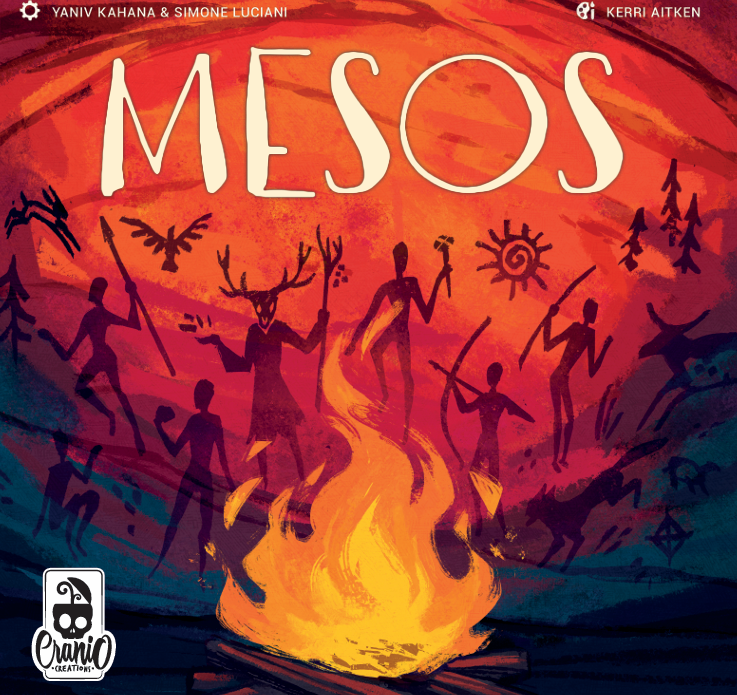
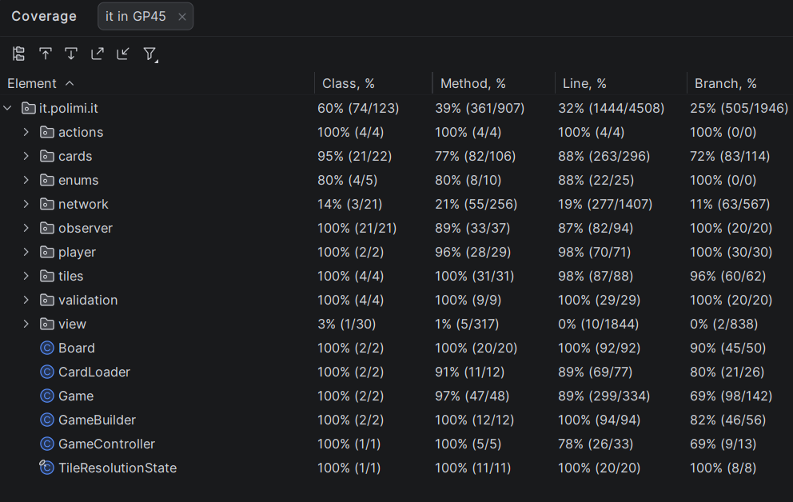

# Mesos - Software Engineering Project

<p align="center">
  
</p>

Mesos is a Java client-server implementation of the board game required by the
course specification. The project provides:

- a Java SE server;
- a Java SE client with TUI and JavaFX GUI;
- Socket TCP and RMI transports, selectable at client startup;
- support for multiple concurrent games and mixed Socket/RMI clients in the
  same game;
- optional MySQL-backed leaderboard persistence.

Technical documentation is written in English, as required by the assignment.
The application UI is partly Italian.

## Requirements

To run the released jars:

- JDK 21
- Optional: MySQL 8.x if the leaderboard database feature must be enabled

No external modules, image folders, fonts, or configuration files are required
to start the game. The released jars are self-contained and include the game
resources they need.

Maven 3.9+ is required only if you want to rebuild the jars from source.

## Delivery Content

The `deliverables/` folder contains the material requested for the final
delivery:

- high-level UML and communication documentation:
  - `deliverables/high-level-uml.drawio.png`
  - `deliverables/client-server-communication.md`
  - `deliverables/final/sequence diagram mesos.pdf`
- project summary UML:
  - `deliverables/uml_sintesi_progetto.png`
- detailed UML:
  - `deliverables/uml_dettaglio.png`
- generated Javadoc:
  - `deliverables/javadoc/index.html`
- test coverage screenshot:
  - `deliverables/TestingCoverage.png`
- prebuilt executable jars:
  - `deliverables/mesos-server.jar`
  - `deliverables/mesos-client.jar`

```text
deliverables/mesos-server.jar
deliverables/mesos-client.jar
```

## Implemented Functionalities

Those are the functionalities we have implemented:

<table>
  <tr>
    <th>Feature</th>
    <th>Status</th>
  </tr>
  <tr><td>Basic rules</td><td align="center">✅</td></tr>
  <tr><td>Complete rules</td><td align="center">✅</td></tr>
  <tr><td>Socket</td><td align="center">✅</td></tr>
  <tr><td>RMI</td><td align="center">✅</td></tr>
  <tr><td>TUI</td><td align="center">✅</td></tr>
  <tr><td>GUI</td><td align="center">✅</td></tr>
  <tr><td>Multiple games</td><td align="center">✅</td></tr>
  <tr><td>Server-state persistence</td><td align="center">❌</td></tr>
  <tr><td>Disconnections</td><td align="center">✅</td></tr>
  <tr><td>Database leaderboard</td><td align="center">✅</td></tr>
</table>

## Build

From the project root:

```bash
mvn clean package
```

The build creates two executable jars:

```text
target/mesos-server.jar  
target/mesos-client.jar
```

The regular Maven artifact `target/GP45-1.0-SNAPSHOT.jar` is also produced, but
the two `mesos-*.jar` files are the intended deliverables for running the game.
After rebuilding, replace the matching files under `deliverables/` if the
prebuilt deliverables must be updated.

The client jar bundles JavaFX native libraries for Linux and Windows. This is
intentional: JavaFX resolves platform-specific native code at GUI startup, so a
client jar built on one operating system must still contain the native libraries
required by the other supported operating system.

## Run The Server

```bash
java -jar deliverables/mesos-server.jar [socketPort] [rmiPort] [cardsJsonPath]
```

Defaults:

```text
socketPort    = 12345
rmiPort       = 12346
cardsJsonPath = cards.json
```

By default the server loads `cards.json` from inside the jar. Passing a third
argument lets you use an external card database file.

Example:

```bash
java -jar deliverables/mesos-server.jar 12345 12346
```

The server opens both transports when possible. If RMI cannot start, the server
continues in Socket-only mode.

## Run A Client

```bash
java -jar deliverables/mesos-client.jar [host] [socketPort]
```

Defaults:

```text
host       = localhost
socketPort = 12345
rmiPort    = socketPort + 1
```

At startup the client asks:

- whether to use TUI or GUI;
- whether to connect through Socket TCP or RMI;
- nickname;
- expected player count;
- totem colour;
- open session to join, or creation of a new game.

Examples:

```bash
java -jar deliverables/mesos-client.jar
java -jar deliverables/mesos-client.jar 192.168.1.10 12345
```

Run one server process and one client process per player.

## Leaderboard Database

The leaderboard uses MySQL. The server looks up database settings in this order:

1. JVM properties, for example `-Ddb.user=mesos`;
2. external `db.properties` next to the server jar;
3. bundled `/db.properties`;
4. fallback defaults.

Default bundled values:

```properties
db.url=jdbc:mysql://localhost:3306/
db.user=root
db.password=root
db.name=GC45_Mesos_DB
```

The configured MySQL user must be able to create the database on first launch
and read/write the leaderboard table. If MySQL is unavailable, the server logs a
warning and the game remains playable without persistent leaderboard updates.

Example with explicit credentials:

```bash
java -Ddb.user=mesos -Ddb.password=secret -jar deliverables/mesos-server.jar
```

## Documentation

- Client-server communication: [`deliverables/client-server-communication.md`](deliverables/client-server-communication.md)
- High-level UML overview: [`deliverables/high-level-uml.drawio.png`](deliverables/high-level-uml.drawio.png)
- Project summary UML: [`deliverables/uml_sintesi_progetto.png`](deliverables/uml_sintesi_progetto.png)
- Sequence diagrams: [`deliverables/final/sequence diagram mesos.pdf`](<deliverables/final/sequence diagram mesos.pdf>)
- UML diagrams currently available in the repository:
  - `deliverables/uml_dettaglio.png`
- Generated Javadoc:

```bash
mvn javadoc:javadoc
```

Output:

```text
target/reports/apidocs/index.html
```

## Tests

```bash
mvn test
```

Database integration tests are disabled by default. Enable them only when MySQL
is configured for the test environment:

```bash
mvn test -Dmesos.it.db=true
```

## Repository Hygiene

Commit source code, documentation, resources, tests, and diagrams that are part
of the delivery. Do not commit:

- `target/`;
- `target/GP45-1.0-SNAPSHOT.jar`;
- local reports used only during review;
- the assignment PDF used as reference;
- temporary lecture material or copied slides;
- IDE workspace files that are not already intentionally tracked.
  

## Testing Coverage




## Credits

The game is distributed in Italy by Cranio Creations ©
