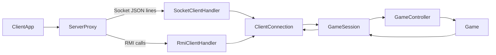
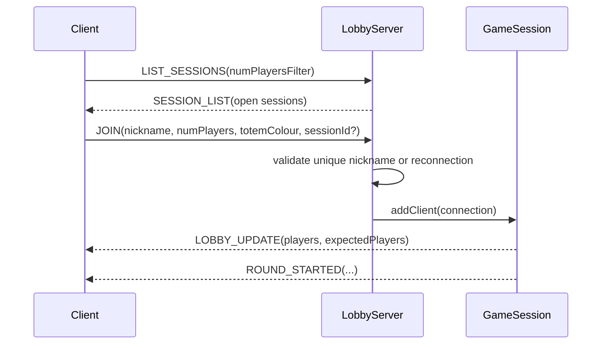

# Client-Server Communication

This document describes the textual protocol and communication approach used by
Mesos. It covers the assignment requirements for a Java SE client-server
application, Socket/RMI transport selection, multiple games, unique nicknames,
viewing game state, and disconnection handling.

## Overview

The server is authoritative: it owns the model, validates every action, advances
the game, and broadcasts immutable snapshots to clients. Clients never mutate
game state directly. A client only sends user choices; the server replies with
events and updated state.

The design follows MVC:

- `Game`, `Board`, cards, players, and tiles are the model.
- `GameController` executes validated player actions on the model.
- `GameView` is implemented by TUI and JavaFX GUI on the client side.
- `ClientController` translates network messages into `GameView` calls.
- `GameSession` adapts model events to network messages for one game.

Both Socket and RMI clients are normalized behind the server-side
`ClientConnection` interface. This is what allows mixed transports in the same
game session.



## Transports

### Socket TCP

The Socket transport sends one UTF-8 JSON message per line. Each message is a
single JSON object with a required `type` field and type-specific payload
fields.

Example:

```json
{"type":"PLACE_TOTEM","playerName":"Alice","tileLetter":"B"}
```

The client connects to the server socket port, optionally asks for open
sessions, then sends `JOIN`. The server keeps one reader thread, one writer
thread, and one watchdog per connected socket client.

### RMI

The RMI transport exposes `RmiServer` in the registry under `MesosServer`.
Clients call:

- `listSessions(numPlayersFilter)`;
- `register(...)`;
- `registerWithSession(...)`.

Registration returns a per-player `RmiPlayerSession` stub. Game actions are
remote method calls on that stub:

- `placeTotem(tileLetter)`;
- `takeCard(cardId, fromTopRow)`;
- `pass()`;
- `postRound(cardId)`;
- `heartbeat()`;
- `disconnect()`.

Server-to-client delivery still uses the same JSON `Message` payloads through
the `RmiClient.receiveMessage(String json)` callback. This keeps Socket and RMI
event handling identical in the client controller.

## Session And Lobby Flow

The lobby supports multiple open games. A client may request the list of waiting
sessions before joining.



A `sessionId` can be:

- absent or blank: automatic matchmaking;
- `NEW`: force creation of a new game;
- an existing session id: direct join to that waiting session.

Nicknames are unique at lobby level. During reconnection, the same nickname may
reclaim its previous player slot if the game is still active and waiting for
that player.

## Message Families

All messages are represented by `Message`: a `type` string plus a JSON payload.
The same message model is used for Socket and for RMI callbacks.

### Client To Server

| Type | Main Fields | Meaning |
| --- | --- | --- |
| `LIST_SESSIONS` | `numPlayersFilter` | Ask for waiting games. |
| `JOIN` | `nickname`, `numPlayers`, `totemColour`, optional `sessionId` | Join or create a game. |
| `PLACE_TOTEM` | `playerName`, `tileLetter` | Place a totem on an offer tile. |
| `TAKE_CARD` | `playerName`, `cardId`, `fromTopRow` | Take a visible card from the current row. |
| `PASS` | `playerName` | Skip the current card slot. |
| `POST_ROUND` | `playerName`, `cardId` | Resolve Watchtower post-round choice; `-1` declines. |
| `HEARTBEAT` | none | Keep the connection alive. |
| `PONG` | none | Legacy ping response. |

### Server To Client

| Type | Main Fields | Meaning |
| --- | --- | --- |
| `SESSION_LIST` | `sessions[]` | Waiting sessions available for join. |
| `LOBBY_UPDATE` | `connectedPlayers`, `expectedPlayers` | Lobby status before game start. |
| `ROUND_STARTED` | `round`, `phase`, `turnOrder`, `board` | Round start or restored round state. |
| `TOTEM_PLACED` | `player`, `tileLetter`, `board` | A player placed a totem. |
| `CARD_SLOT_READY` | `player`, `isTopRow`, `availableCards`, `visibleEvents`, `slotsRemaining` | A player must choose a card or pass. |
| `CARD_ACQUIRED` | `player`, `card` | A card was acquired. |
| `CARD_ACQUISITION_FAILED` | `player`, `card`, `missingFood`, `fromTopRow`, `alternatives` | Building acquisition failed for lack of food. |
| `TOTEM_RETURNED` | `player`, `position`, `board` | A totem returned to the Turn Order Tile. |
| `POST_ROUND_STARTED` | `round`, `watchtowerPlayers`, `availableCards` | Watchtower post-round phase. |
| `EVENT_RESOLVED` | `eventId`, `era`, `eventType`, `deltas` | Event card effects were applied. |
| `ERA_CHANGED` | `newEra` | A new era started. |
| `ROUND_ENDED` | `round` | Round lifecycle completed. |
| `GAME_ENDED` | `winners`, `finalScores`, `scoreBreakdowns` | Final score and winners. |
| `LEADERBOARD` | `recipient`, `myScore`, `myRank`, `totalEntries`, `numPlayers`, `entries`, `playerWinCounts` | Persistent leaderboard data. |
| `PLAYER_DISCONNECTED` | `nickname` | A player disconnected but the game continues. |
| `PLAYER_RECONNECTED` | `nickname` | A player rejoined an active game. |
| `ERROR` | `reason` | Rejected action, setup failure, or informational server message. |

## Snapshot Payloads

The server sends snapshots instead of model objects. Important payloads are:

- `PlayerSnapshot`: nickname, totem, food, prestige points, turn order,
  acquired characters, acquired buildings.
- `BoardSnapshot`: offer tiles, Turn Order Tile, tribe deck size.
- `OfferTileSnapshot`: tile letter, card slots, food-only flag, free/occupied
  state, placed totem, current top and bottom row card lists.
- `CardSnapshot`: id, era, type, character type, cost/final points, effect
  description, and character-specific details when applicable.
- `FinalScoreBreakdown`: final scoring components shown at game end.

This satisfies the requirement that each client can display both its own state
and other players' visible state without querying the server outside the event
stream.

## Heartbeat And Disconnections

Clients send periodic `HEARTBEAT` messages. Any game action also refreshes the
last-seen timestamp. Server handlers use watchdogs to detect silent clients.

Current timing:

- client heartbeat interval: 5 seconds;
- Socket/RMI handler timeout: 30 seconds;
- game suspension timeout when only one player remains connected: 120 seconds.

If a player disconnects before the game starts, the session is terminated. If a
player disconnects during a started game, the model skips or defers that player
according to the current phase and broadcasts `PLAYER_DISCONNECTED`. A reconnect
with the same nickname restores the player connection and broadcasts
`PLAYER_RECONNECTED`.

## Persistence Messages

At game end the server sends `GAME_ENDED`. If the MySQL leaderboard is
available, the server then sends a personalized `LEADERBOARD` message to each
client. If the database is unavailable, the game still ends normally and clients
show the local final ranking.

The server database configuration is independent from the protocol and is
documented in the project README.

